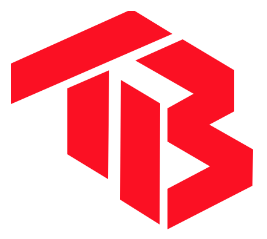

  

# TRIBYTE

Somos uma equipe de estudantes de Desenvolvimento de Sistemas no SENAI. Este portfólio reúne os projetos que fizemos juntos, os estudos de interface e os trabalhos que ainda estamos desenvolvendo.

[Acessar o portfólio](https://portifolio-tribyte.vercel.app/) · [Ver os projetos](#projetos)

## Projetos

| Trabalho | Sobre o projeto |
| --- | --- |
| [SENAI Smart Class](https://senai-smart-class-one.vercel.app/) | Projeto acadêmico feito em equipe: um painel para acompanhar sensores e controlar equipamentos de uma sala. A demonstração usa leituras simuladas quando o hardware está desconectado. |
| Painel comercial | Estudo visual de um painel de vendas e metas. Os dados apresentados são fictícios. |
| Vio Finanças | Projeto pessoal de Márcio Andrey para organização financeira. Está em desenvolvimento e ainda não tem demonstração pública. |
| Portfólio TRIBYTE | O site da equipe, com nossos trabalhos, perfis e formas de contato. |

## Equipe

- [Gustavo de Brito Vieira](https://github.com/GustavobritoTDS)
- [Márcio Andrey](https://github.com/marcioandrey627-code)
- [Lucas Duarte Costa](https://github.com/lucasduartecosta09)

[Conheça cada integrante no portfólio](https://portifolio-tribyte.vercel.app/#estudio).

## Sites e sistemas

Podemos desenvolver um site para apresentar seu negócio, um sistema para organizar informações da equipe ou uma página para divulgar um produto ou uma campanha.

[Veja os tipos de projeto](https://portifolio-tribyte.vercel.app/#servicos).

## Contato

Conte o que você precisa na área de contato do site. Você pode chamar a equipe no WhatsApp ou preparar uma mensagem com os detalhes do projeto e revisá-la antes de enviar.

[Conversar com a TRIBYTE](https://portifolio-tribyte.vercel.app/#contato)
