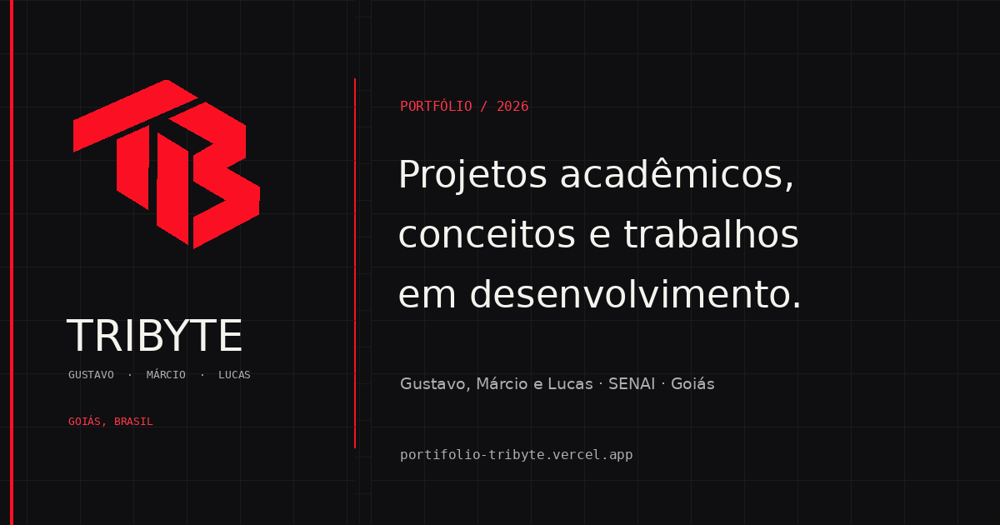

# TRIBYTE — Portfólio

**Sites, sistemas e experiências digitais com identidade própria.**

Projeto de portfólio desenvolvido pela **TRIBYTE**, equipe formada por Gustavo de Brito Vieira, Márcio Andrey e Lucas Duarte Costa, estudantes de Desenvolvimento de Sistemas no SENAI. Reúne trabalhos acadêmicos, demonstrações e conceitos de interfaces web.

[**Conhecer o site**](https://portifolio-tribyte.vercel.app/) · [**Explorar o Smart Class**](https://senai-smart-class-one.vercel.app/) · [**Documentação técnica**](LEIAME.md)



## Sobre o projeto

O site apresenta a equipe, suas especialidades e projetos em um ambiente responsivo. A proposta é combinar **clareza na apresentação**, **identidade visual consistente** e **interações cuidadosas**, sem depender de um framework para renderizar a página.

### Principais recursos

- Interface responsiva para celular, tablet e desktop.
- Identidade visual própria, com temas claro e escuro.
- Abertura animada da marca e transições ligadas à navegação e à rolagem.
- Páginas e seções para serviços, equipe e projetos.
- Galerias e detalhes de trabalhos, com imagens reais quando disponíveis.
- Contato por WhatsApp com mensagem revisada pelo visitante.
- Metadados para compartilhamento, sitemap e cabeçalhos de segurança.

## Projetos apresentados

| Projeto | Natureza | Descrição |
| --- | --- | --- |
| **SENAI Smart Class** | Acadêmico, em equipe | Painel de acompanhamento e automação de sala com leituras e controles simulados. |
| **Painel comercial** | Conceito de interface | Demonstração visual de fluxos de vendas e gestão, sem representar cliente em produção. |
| **Vio Finanças** | Projeto pessoal de integrante | Trabalho em desenvolvimento, sem demonstração pública anunciada. |
| **TRIBYTE** | Portfólio da equipe | Site e identidade visual para apresentar competências e projetos. |

O projeto **Smart Class** possui um [repositório próprio com documentação](https://github.com/GustavobritoTDS/Painel-De-Controle-SALA). As demonstrações conceituais são identificadas como tal; não representam resultados comerciais ou clientes fictícios como reais.

## Tecnologias

- **HTML5:** estrutura semântica e conteúdo.
- **CSS3:** layout responsivo, componentes, temas e animações.
- **JavaScript:** navegação, interação, galerias, efeitos e contato.
- **Vercel:** hospedagem e publicação contínua a partir da branch `main`.

A solução principal funciona como um site estático, sem build ou dependências de servidor.

## Executar localmente

Clone o repositório:

```bash
git clone https://github.com/GustavobritoTDS/Portifolio-empresa.git
cd Portifolio-empresa
python -m http.server 8000
```

Depois, acesse **http://localhost:8000**. Alternativamente, utilize a extensão Live Server do VS Code.

## Estrutura do repositório

| Caminho | Finalidade |
| --- | --- |
| `index.html` | Estrutura, conteúdo e metadados |
| `styles.css` | Estilos, responsividade, componentes e animações |
| `script.js` | Conteúdo dinâmico, projetos e interações |
| `site-init.js` / `intro.js` | Inicialização e abertura da marca |
| `reactbits-effects.js` | Efeitos e interações selecionados |
| `assets/` | Identidade visual, capturas, fotografias e fontes |
| `docs/` | Decisões e documentação complementar |
| `vercel.json` | Configurações da publicação |

Para detalhes sobre arquitetura, publicação, licenças de fontes e comportamento do contato, consulte [LEIAME.md](LEIAME.md) e [decisões do portfólio](docs/decisoes-do-portfolio.md).

## Equipe

Desenvolvido por **Gustavo de Brito Vieira**, **Márcio Andrey** e **Lucas Duarte Costa**.

Quer conhecer nossos trabalhos ou conversar sobre um projeto? Acesse o [**portfólio da TRIBYTE**](https://portifolio-tribyte.vercel.app/).

---

*Portfólio em evolução. As funcionalidades documentadas se referem à versão deste repositório; projetos acadêmicos, conceitos e entregas comerciais são apresentados separadamente.*
